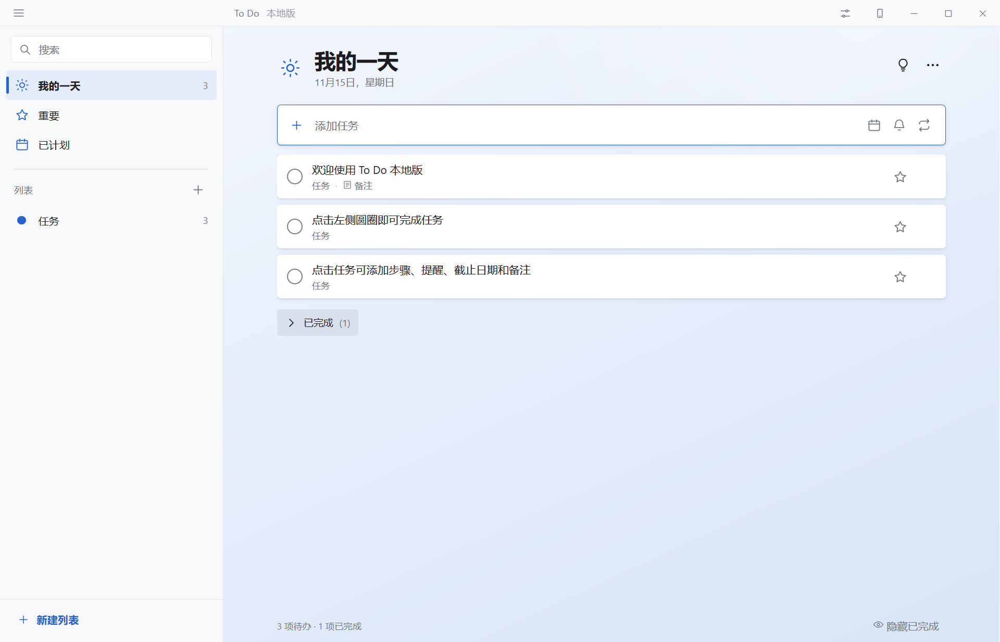
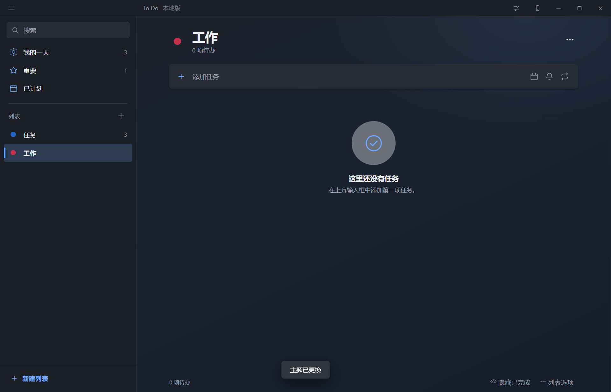

# ToDoLocal

> 类 Microsoft To Do 的**纯本地离线**任务清单桌面应用。无需账号、无需联网，数据只保存在你自己的电脑上。

基于 Electron 45 与原生 HTML / CSS / JavaScript 构建，零前端框架、零外部资源、零云端依赖。主进程通过 IPC 读写本地 JSON 文件，并在网络层拦截所有非本地 URL 请求。



## 为什么做这个

市面上的任务清单大多要求注册账号、数据上云。ToDoLocal 的目标是把熟悉的 Microsoft To Do 交互体验完整搬到桌面，同时把数据主权交还给用户：

- **严格离线**：`session.webRequest` 拦截一切 `file:` / `data:` / `blob:` 之外的请求，Electron 自身的后台联网（更新探测、组件更新、DNS 预取）也被关闭。
- **数据自主**：单一 `data.json`，原子写入（临时文件 + rename），支持一键导出 / 导入 JSON 备份，可随目录整体搬走。
- **绿色便携**：数据文件固定在软件目录，不写入注册表、不污染系统目录。

## 功能

| 模块 | 说明 |
| --- | --- |
| 智能列表 | 我的一天（跨零点自动重置）、重要、已计划 |
| 自定义列表 | 新建 / 重命名 / 删除 / 排序 / 主题色，任务可在列表间移动、复制 |
| 任务 | 完成、星标、步骤、备注、截止日期、提醒、重复规则、拖拽排序、已完成折叠 |
| 组织 | 全局搜索、多种排序、右键菜单（含「今天 / 明天到期」「根据任务建列表」） |
| 详情面板 | 卡片内步骤展开、关联工作文件夹（选择目录并调用系统文件管理器打开） |
| 外观 | 6 套主题（含深色）、侧栏折叠、迷你小面板（清单 ↔ 详情平推，尺寸偏好记忆） |
| Windows 集成 | 系统托盘常驻（关闭窗口 = 隐藏到托盘）、开机自启、本地通知、无边框窗口、单实例锁 |

### 截图

| 深色主题 | 迷你小面板 |
| --- | --- |
|  |  |

任务右键菜单提供 12 项操作，详情见 [右键菜单截图](docs/screenshots/context-menu.png)。

## 快速开始

### 环境要求

- Windows 10 / 11（x64）
- Node.js 18+ 与 npm

### 运行源码

```bash
npm install
npm start
```

数据文件在开发态位于 `%APPDATA%/ToDoLocal/data/data.json`。

### 打包

```bash
npm run dist
```

electron-builder 输出到 `release/`。绿色版目录结构为 `release/win-unpacked/`，应用图标取自 `build/icon.ico`；图标可用 `python build/gen_icon.py` 重新生成（纯 Python 标准库，无第三方依赖）。

> 国内网络提示：若 Electron 二进制下载失败，可设置镜像后手动补齐：
> ```bash
> ELECTRON_MIRROR=https://npmmirror.com/mirrors/electron/ node node_modules/electron/install.js
> ```
> 仓库内的 `.npmrc` 已配置 npmmirror 源。

### 自动化验收

`tools/verify.js` 会启动真实 Electron 窗口，执行 29 项交互与落盘断言，并输出截图到 `verify-out/`：

```bash
npx electron tools/verify.js
```

部分宿主环境会注入 `ELECTRON_RUN_AS_NODE=1`，此时需先清除该变量：

```bash
env -u ELECTRON_RUN_AS_NODE npx electron tools/verify.js
```

## 数据与安全

| 项目 | 说明 |
| --- | --- |
| 绿色版数据位置 | `<软件目录>/ToDoLocal-Data/data.json` |
| 开发态数据位置 | `%APPDATA%/ToDoLocal/data/data.json` |
| 写入策略 | 先写 `data.json.tmp` 再 `rename` 原子替换；窗口关闭前 `sendSync` 兜底落盘 |
| 备份 | 设置菜单中导出 / 导入 JSON |
| 网络 | 应用层无任何出站请求；主进程显式拦截外部 URL |

提醒功能仅在应用运行时生效，不注册后台服务。成品未做代码签名，首次运行可能触发 Windows SmartScreen，需选择「更多信息 → 仍要运行」。

## 项目结构

```
src/
  main.js       Electron 主进程：窗口 / 托盘 / IPC / 数据文件 / 网络拦截
  preload.js    contextBridge 暴露的最小 API（contextIsolation: true）
  index.html    界面结构与内联 SVG 图标
  styles.css    全部样式与 6 套主题
  app.js        渲染层状态管理、渲染、命令与事件
  icon.ico      开发态窗口 / 托盘图标
build/         应用图标资源与生成脚本
tools/verify.js 真实 Electron 环境自动化验收（29 项）
docs/screenshots/  README 截图
```

## 贡献

欢迎提交 Issue 与 Pull Request，请先阅读 [CONTRIBUTING.md](CONTRIBUTING.md)。本项目保持「零运行时依赖、严格离线」的设计边界，任何引入网络请求或第三方前端框架的方案都需要先讨论。

## 许可证

[MIT](LICENSE) © 2026 nsq4926
